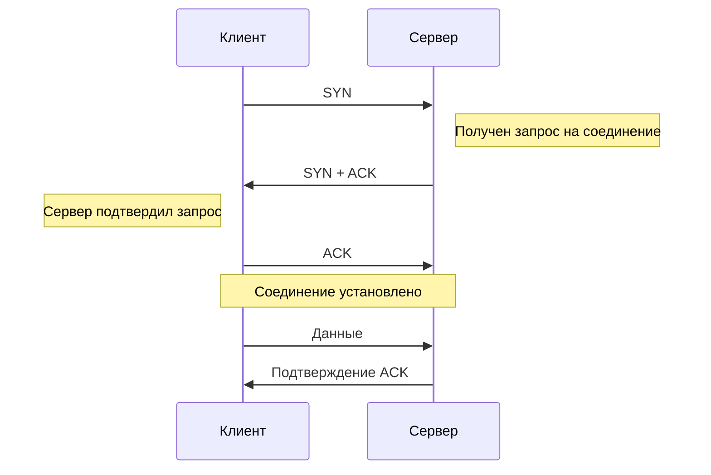
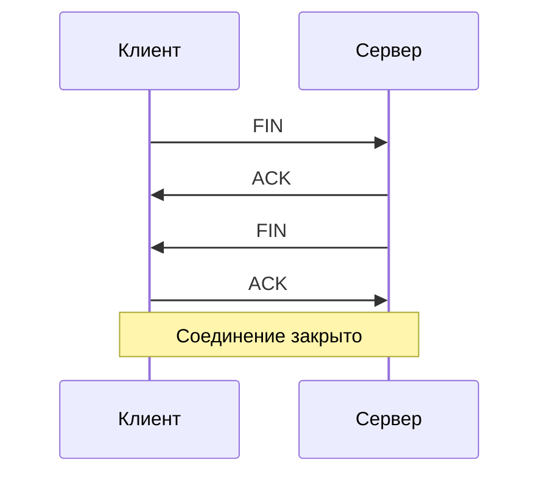

## Теория

### Что такое TCP

TCP (Transmission Control Protocol) - транспортный протокол, обеспечивающий надёжную и упорядоченную передачу потока байтов между двумя конечными точками.
Например, при передаче файла приложение не должно самостоятельно выяснять, потерялся ли каждый отдельный фрагмент. Эту работу выполняет TCP.
TCP работает поверх IP и решает задачи, которые сам IP не гарантирует:
- контроль получения данных;
- повторную передачу потерянных сегментов;
- восстановление правильного порядка данных;
- управление потоком;
- управление перегрузкой сети.


### Установление соединения. Three-way Handshake

Перед обменом данными TCP устанавливает соединение.

Три этапа:

1. SYN - клиент просит установить соединение.
2. SYN-ACK - сервер подтверждает запрос и сообщает о готовности.
3. ACK - клиент подтверждает ответ сервера.

После этого стороны могут передавать данные.

### Передача данных и надёжность

TCP разбивает поток байтов на сегменты. Каждый сегмент содержит служебную информацию, в том числе номера последовательности и подтверждения.

Упрощённый пример:

```
Клиент отправляет:
"HELLO WORLD"

TCP может передать данные несколькими сегментами:

Сегмент 1: HELLO
Сегмент 2: WORLD
```

Получатель восстанавливает исходный порядок байтов.
Если сегмент потерялся, TCP может обнаружить проблему и выполнить повторную передачу.
TCP обеспечивает упорядоченный поток байтов, но не сохраняет границы сообщений приложения.
Например, приложение отправило:
```cs
socket.Send(Encoding.UTF8.GetBytes("HELLO"));
socket.Send(Encoding.UTF8.GetBytes("WORLD"));
```

Получатель не обязан получить два отдельных результата `Receive()`. Он может получить:
```
HELLOWORLD
```

или сначала:
```
HEL
```

а затем:
```
LOWORLD
```

Поэтому для прикладного протокола нужно самостоятельно определить границы сообщений: например, использовать разделитель или заголовок с длиной сообщения. В предыдущих практических работах мы уже использовали заголовок длины перед JSON.

### Завершение соединения

Обычное корректное завершение TCP-соединения использует обмен FIN и ACK. В упрощённом варианте каждая сторона отдельно закрывает направление передачи данных.

`FIN` означает, что сторона больше не будет отправлять данные. Получение `FIN` на стороне приложения обычно приводит к тому, что `Receive()` возвращает `0`, когда все ранее отправленные данные уже прочитаны.

`RST` используется для аварийного сброса соединения.

### Где применяется TCP

- веб-сайты и HTTPS;
- передача файлов;
- электронная почта;
- подключение к базам данных;
- клиент-серверные приложения, где важна надёжная доставка.

## Практика

### Практическая работа: исследование TCP-соединения

Задача: создать TCP-сервер и TCP-клиент на C#, передать данные, изучить установление и завершение соединения в Wireshark.
В этой работе используем `TcpListener` и `TcpClient`. Это более высокоуровневые классы .NET для работы с TCP, чем `Socket`.

### Создание проекта

Создайте проект:
```
dotnet new console -n TcpLesson
cd TcpLesson
```

В приложении будут два режима запуска:
- `server` - запуск сервера;
- `client` - запуск клиента.

### Реализация TCP-сервера
#### Program.cs
```cs
using System.Net;
using System.Net.Sockets;
using System.Text;

const int port = 5000;

if (args.Length == 0) {
    Console.WriteLine("Укажите режим: server или client");
    return;
}

if (args[0].Equals("server", StringComparison.OrdinalIgnoreCase)) {
    await RunServerAsync();
} else if (args[0].Equals("client", StringComparison.OrdinalIgnoreCase)) {
    await RunClientAsync();
} else {
    Console.WriteLine("Неизвестный режим.");
}

async Task RunServerAsync() {
    TcpListener listener = new TcpListener(IPAddress.Loopback, port);
    listener.Start();
    Console.WriteLine($"TCP-сервер запущен на порту {port}");
    Console.WriteLine("Ожидание клиента...");
    try {
        using TcpClient client = await listener.AcceptTcpClientAsync();
        Console.WriteLine($"Подключен клиент: {client.Client.RemoteEndPoint}");
        using NetworkStream stream = client.GetStream();
        byte[] buffer = new byte[8];
        while (true) {
            int bytesRead = await stream.ReadAsync(buffer, 0, buffer.Length);
            if (bytesRead == 0) {
                Console.WriteLine("Клиент завершил передачу данных.");
                break;
            }
            string received = Encoding.UTF8.GetString(buffer, 0, bytesRead);
            Console.WriteLine($"Получено {bytesRead} байт: \"{received}\"");
        }
    } finally {
        listener.Stop();
        Console.WriteLine("Сервер остановлен.");
    }
}

async Task RunClientAsync() {
    using TcpClient client = new TcpClient();
    Console.WriteLine("Подключение к серверу...");
    await client.ConnectAsync(IPAddress.Loopback, port);
    Console.WriteLine("Соединение установлено.");
    using NetworkStream stream = client.GetStream();
    string[] messages = { "HELLO ", "WORLD" };
    foreach (string message in messages) {
        byte[] data = Encoding.UTF8.GetBytes(message);
        await stream.WriteAsync(data, 0, data.Length);
        Console.WriteLine($"Отправлено: \"{message}\"");
        await Task.Delay(500);
    }
    client.Client.Shutdown(SocketShutdown.Send);
    Console.WriteLine("Передача данных завершена.");
}
```

Обратите внимание: размер буфера сервера составляет 8 байт, а клиент отправляет две части данных с интервалом в 500 мс.
Это позволяет наблюдать чтение TCP-потока, но не гарантирует, что каждому вызову `WriteAsync()` будет соответствовать отдельный вызов `ReadAsync()`.

### Запуск и проверка
Откройте два терминала в папке проекта.
Терминал №1 - сервер:
```
dotnet run -- server
```

Терминал №2 - клиент:
```
dotnet run -- client
```

Пример возможного вывода сервера:
```
TCP-сервер запущен на порту 5000
Ожидание клиента...
Подключен клиент: 127.0.0.1:XXXXX
Получено 6 байт: "HELLO "
Получено 5 байт: "WORLD"
Клиент завершил передачу данных.
Сервер остановлен.
```

`XXXXX` - динамический порт клиента. Количество и размеры операций чтения могут отличаться.

Задания для проверки:

1. Измените размер буфера с 8 на 3 байта.
2. Уберите `Task.Delay(500)` на клиенте.
3. Отправьте строку длиной 30–50 символов.
4. Объясните, почему сервер может получить данные несколькими частями.
5. Объясните, почему `bytesRead == 0` не означает, что сервер получил пустое сообщение.

### Исследование TCP в Wireshark

Запустите Wireshark и выберите интерфейс Loopback (на Windows он может называться `Adapter for loopback traffic capture`).

Установите фильтр:
```
tcp.port == 5000
```

Повторно запустите сервер и клиента.
Найдите в захвате следующие события:

|Событие|Что искать|
|---|---|
|Запрос соединения|`SYN`|
|Ответ сервера|`SYN, ACK`|
|Подтверждение|`ACK`|
|Передача данных|TCP-сегменты с данными|
|Завершение передачи|`FIN, ACK` или `FIN` и `ACK`|

Для поиска отдельных пакетов используйте:

```
tcp.flags.syn == 1
```

```
tcp.flags.fin == 1
```

```
tcp.port == 5000 && tcp.len > 0
```

![[Pasted image 20261124105704.png|444]]

![[Pasted image 20261124105712.png|402]]

![[Pasted image 20261124105722.png|550]]

Задания в Wireshark:

1. Найдите первый пакет `SYN`.
2. Найдите ответный пакет `SYN, ACK`.
3. Найдите пакет `ACK`, завершающий установление соединения.
4. Определите порт сервера и динамический порт клиента.
5. Найдите пакеты с передаваемыми данными.
6. Найдите завершение соединения.
7. Сравните время установления соединения и время передачи данных.

### Дополнительные задания

Задание 1. Несколько подключений
Измените сервер так, чтобы он мог последовательно обслуживать нескольких клиентов.
Подсказка: после завершения обработки клиента сервер не должен завершаться. Перенесите `AcceptTcpClientAsync()` и обработку клиента в цикл.

Задание 2. Ответ сервера
Добавьте ответ клиенту после получения данных.
Например, сервер отправляет:
```
SERVER RECEIVED: HELLO WORLD
```

Для этого используйте:
```cs
byte[] response = Encoding.UTF8.GetBytes("SERVER RECEIVED");

await stream.WriteAsync(response, 0, response.Length);
```

На клиенте после отправки данных необходимо прочитать ответ сервера через `ReadAsync()`.

Задание 3. Проверка отключения
Принудительно закройте клиент во время передачи данных. Посмотрите, как сервер реагирует на отключение.

## Критерии оценивания

| Критерий                                  | Баллы |
| ----------------------------------------- | ----- |
| Сервер запускается и принимает соединение | 2     |
| Клиент подключается к серверу             | 2     |
| Передача данных работает корректно        | 2     |
| Найдены этапы TCP Handshake в Wireshark   | 2     |
| Найдено завершение соединения             | 2     |
| Ответы на контрольные вопросы             | 2     |
| Итого                                     | 12    |
