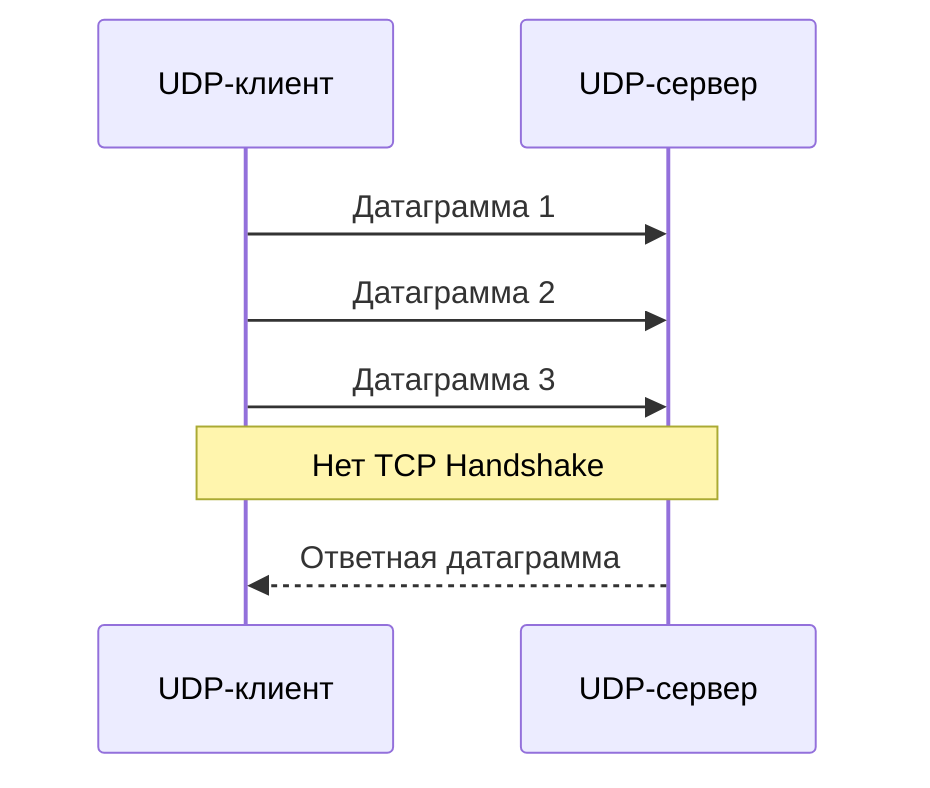
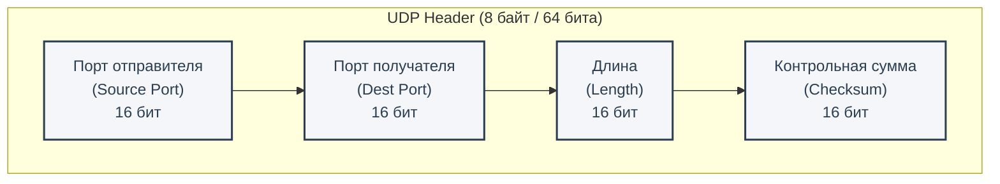

## Теория

### Что такое UDP

UDP (User Datagram Protocol) - транспортный протокол, который позволяет отправлять отдельные датаграммы между приложениями без предварительного установления TCP-подобного соединения.

В отличие от TCP, UDP не обеспечивает средствами самого протокола:
- гарантированную доставку;
- повторную передачу потерянных датаграмм;
- сохранение порядка доставки;
- управление потоком данных между приложениями.

UDP не означает, что данные обязательно потеряются. Это означает, что приложение не получает от UDP гарантий, аналогичных TCP.

Например, если отправитель передал три датаграммы:

```
Пакет 1: HELLO
Пакет 2: WORLD
Пакет 3: TEST
```

Получатель может получить:
```
HELLO
WORLD
TEST
```

Но также возможны ситуации:
```
HELLO
TEST
```

или:
```
TEST
HELLO
WORLD
```

Приложение должно самостоятельно обрабатывать ситуации, в которых важны подтверждения, порядок или повторная отправка.

### Как работает UDP

UDP не выполняет трёхэтапное TCP-рукопожатие перед отправкой данных.

Основные этапы:
1. Клиент формирует датаграмму.
2. Отправляет её на IP-адрес и UDP-порт сервера.
3. Сервер принимает датаграмму.
4. Сервер при необходимости отправляет ответ.

Серверу не нужно принимать TCP-соединение через `Accept()`. Он ожидает поступления датаграмм.

### Датаграмма UDP

UDP работает с отдельными сообщениями - датаграммами.
Упрощённая структура UDP-заголовка:



UDP-заголовок занимает 8 байт.

Основные поля:

| Поле              | Назначение                                     |
| ----------------- | ---------------------------------------------- |
| Порт отправителя  | Порт приложения, отправившего датаграмму       |
| Порт получателя   | Порт приложения, которому предназначены данные |
| Длина             | Размер UDP-заголовка вместе с данными          |
| Контрольная сумма | Проверка целостности заголовка и данных        |

Важное отличие от TCP: границы датаграмм сохраняются на уровне UDP API. Один вызов отправки формирует одну датаграмму, а один вызов приёма получает одну датаграмму.
Однако слишком большая датаграмма может фрагментироваться на уровне IP или не пройти через сеть. Поэтому в прикладных протоколах обычно стараются передавать небольшие сообщения.

### TCP и UDP: сравнение

| Характеристика          | TCP                                      | UDP                            |
| ----------------------- | ---------------------------------------- | ------------------------------ |
| Установление соединения | Да                                       | Нет                            |
| Тип передачи            | Поток байтов                             | Датаграммы                     |
| Гарантия доставки       | Да, пока соединение успешно работает     | Нет                            |
| Сохранение порядка      | Да                                       | Нет                            |
| Повторная передача      | Выполняется TCP                          | Приложение при необходимости   |
| Границы сообщений       | Не сохраняются                           | Сохраняются                    |
| Служебный заголовок     | Минимум 20 байт                          | 8 байт                         |
| Скорость и задержки     | Есть дополнительные механизмы управления | Меньше обязательных механизмов |


Примеры использования UDP:

- онлайн-игры;
- голосовая и видеосвязь;
- DNS-запросы;
- передача телеметрии;
- приложения реального времени.

При этом современные протоколы могут реализовывать собственные механизмы надёжности поверх UDP.

### Основные классы .NET для UDP

Для работы с UDP можно использовать:

- `UdpClient` - высокоуровневая обёртка;
- `Socket` - низкоуровневый API, позволяющий управлять параметрами сокета;
- `IPEndPoint` - IP-адрес и порт;
- `IPAddress` - IP-адрес.

Сегодня работаем с `UdpClient`.

Основные методы:

| Метод            | Назначение                                      |
| ---------------- | ----------------------------------------------- |
| `Send()`         | Отправка датаграммы                             |
| `SendAsync()`    | Асинхронная отправка                            |
| `Receive()`      | Получение датаграммы                            |
| `ReceiveAsync()` | Асинхронное получение                           |
| `Close()`        | Закрытие UDP-клиента                            |
| `Connect()`      | Установка адреса удалённой стороны по умолчанию |

Важно: `UdpClient.Connect()` не создаёт TCP-подобное соединение и не выполняет рукопожатие. Он задаёт удалённую конечную точку для обмена и ограничивает приём датаграмм указанным адресом.

## Практика

### Практическая работа: создание UDP-клиента и UDP-сервера

Задача: создать приложение, в котором клиент отправляет отдельные сообщения UDP-серверу, а сервер принимает их и отправляет ответ.
В отличие от предыдущего TCP-занятия, здесь не будет `TcpListener`, `TcpClient`, `NetworkStream` и `AcceptAsync()`.

Будем работать с `UdpClient`.

### Создание проекта

Создайте проект:
```
dotnet new console -n UdpLesson
cd UdpLesson
```

В проекте будет два режима запуска:
- `server` - UDP-сервер;
- `client` - UDP-клиент.

Порт сервера - `5001`.

### Реализация UDP-сервера

#### Program.cs
```cs

using System.Net;
using System.Net.Sockets;
using System.Text;
const int port = 5001;
if (args.Length == 0)
{
    Console.WriteLine("Укажите режим: server или client");
    return;
}
if (args[0].Equals("server", StringComparison.OrdinalIgnoreCase))
{
    await RunServerAsync();
}
else if (args[0].Equals("client", StringComparison.OrdinalIgnoreCase))
{
    await RunClientAsync();
}
else
{
    Console.WriteLine("Неизвестный режим.");
}
// Здесь сервер не принимает соединение. Он получает датаграммы от разных клиентов и может отправлять ответ на адрес отправителя.
async Task RunServerAsync()
{
	// создаёт UDP-сервер, привязанный к порту.
    using UdpClient server = new UdpClient(port);
    Console.WriteLine($ "UDP-сервер запущен на порту {port}");
    Console.WriteLine("Ожидание датаграмм...");
    while (true)
    {
	    // server.ReceiveAsync ожидает поступления датаграммы
        UdpReceiveResult result = await server.ReceiveAsync();
        // result.Buffer содержит данные принятой датаграммы
        string message = Encoding.UTF8.GetString(result.Buffer);
        Console.WriteLine($ "Получено от {result.RemoteEndPoint}: {message}");
        if (message.Equals("exit", StringComparison.OrdinalIgnoreCase))
        {
            byte[] exitResponse = Encoding.UTF8.GetBytes("Сервер получил команду завершения.");
            
            // server.SendAsync отправляет ответ конкретному отправителю
            // result.RemoteEndPoint содержит адрес и порт отправителя
            await server.SendAsync(exitResponse, result.RemoteEndPoint);
            Console.WriteLine("Команда завершения получена.");
            break;
        }
        string responseText = $ "SERVER RECEIVED: {message}";
        byte[] response = Encoding.UTF8.GetBytes(responseText);
        await server.SendAsync(response, result.RemoteEndPoint);
    }
    Console.WriteLine("UDP-сервер остановлен.");
}
async Task RunClientAsync()
{
    using UdpClient client = new UdpClient();
    IPAddress address = IPAddress.Loopback;
    IPEndPoint serverEndpoint = new IPEndPoint(address, port);
    Console.WriteLine($ "UDP-клиент. Сервер: {serverEndpoint}");
    Console.WriteLine("Введите сообщение или exit для завершения.");
    while (true)
    {
        Console.Write("> ");
        string ? message = Console.ReadLine();
        if (string.IsNullOrWhiteSpace(message))
        {
            continue;
        }
        byte[] data = Encoding.UTF8.GetBytes(message);
        await client.SendAsync(data, serverEndpoint);
        UdpReceiveResult result = await client.ReceiveAsync();
        string response = Encoding.UTF8.GetString(result.Buffer);
        Console.WriteLine($ "Ответ сервера: {response}");
        if (message.Equals("exit", StringComparison.OrdinalIgnoreCase))
        {
            break;
        }
    }
}
```


### Запуск и проверка

Откройте два терминала.

Терминал №1 - сервер:

```
dotnet run -- server
```

Терминал №2 - клиент:

```
dotnet run -- client
```

Отправьте несколько сообщений:

```
Привет
Первое сообщение
Второе сообщение
Проверка UDP
```

Пример вывода клиента:

```
UDP-клиент. Сервер: 127.0.0.1:5001
Введите сообщение или exit для завершения.
> Привет
Ответ сервера: SERVER RECEIVED: Привет
> Первое сообщение
Ответ сервера: SERVER RECEIVED: Первое сообщение
> Второе сообщение
Ответ сервера: SERVER RECEIVED: Второе сообщение
> exit
Ответ сервера: Сервер получил команду завершения.
```

Пример вывода сервера:

```
UDP-сервер запущен на порту 5001
Ожидание датаграмм...
Получено от 127.0.0.1:XXXXX: Привет
Получено от 127.0.0.1:XXXXX: Первое сообщение
Получено от 127.0.0.1:XXXXX: Второе сообщение
Получено от 127.0.0.1:XXXXX: exit
Команда завершения получена.
UDP-сервер остановлен.
```

`XXXXX` - динамический порт клиента.

Задания для проверки:

1. Измените текст ответа сервера.
2. Отправьте сообщение длиной 100 символов.
3. Отправьте сообщение на русском языке.
4. Запустите два клиента одновременно.
5. Проверьте, что сервер получает сообщения от обоих клиентов и может отвечать каждому.

### Исследование UDP в Wireshark

Запустите Wireshark и выберите интерфейс Loopback.

Установите фильтр:

```
udp.port == 5001
```

Повторно запустите сервер и клиента, отправьте несколько сообщений.

В Wireshark найдите:

|Что исследовать|На что обратить внимание|
|---|---|
|UDP-пакет клиента|Порт отправителя и получателя|
|UDP-пакет сервера|Изменение портов местами|
|Данные UDP|Содержимое переданного сообщения|
|Размер датаграммы|Размер UDP-заголовка и данных|
|Несколько сообщений|Каждое отправленное сообщение передаётся отдельной датаграммой|

Дополнительные фильтры:

```
udp
```

```
udp.port == 5001 && udp.length > 8
```

```
ip.addr == 127.0.0.1 && udp.port == 5001
```

Задания в Wireshark:

1. Найдите датаграмму с сообщением `Привет`.
2. Определите порт клиента.
3. Определите порт сервера.
4. Найдите ответную датаграмму.
5. Сравните адреса и порты отправителя и получателя в запросе и ответе.
6. Найдите UDP-заголовок и определите его размер.
7. Подсчитайте количество датаграмм, переданных при отправке трёх сообщений и получении ответов.

### Эксперименты с UDP. Выполните следующие задания.

Задание 1. Отправка без ожидания ответа

Измените клиент так, чтобы он мог отправить датаграмму, не ожидая ответа сервера.

Замените участок:

```cs
await client.SendAsync(data, serverEndpoint);
UdpReceiveResult result = await client.ReceiveAsync();
string response = Encoding.UTF8.GetString(result.Buffer);
Console.WriteLine($"Ответ сервера: {response}");
```

на:

```cs
await client.SendAsync(data, serverEndpoint);
Console.WriteLine("Датаграмма отправлена.");
```

Проверьте, что сервер продолжает получать сообщения, хотя клиент больше не ожидает ответ.
Объясните, почему отсутствие ответа не означает, что отправка обязательно не удалась.


Задание 2. Подсчёт принятых датаграмм
Добавьте серверу счётчик:
```cs
int receivedCount = 0;
```

После получения каждой датаграммы увеличивайте его:
```cs
receivedCount++;

Console.WriteLine($"Всего получено датаграмм: {receivedCount}");
```
Проверьте работу счётчика при подключении двух клиентов.


Задание 3. Ограничение размера сообщения
Добавьте проверку размера полученной датаграммы:
```cs
if (result.Buffer.Length > 1024)
{
	Console.WriteLine("Сообщение слишком большое.");
	continue;
}
```
Проверьте результат на коротком и длинном сообщении.


Задание 4. Обработка пустых сообщений
Измените клиент так, чтобы он мог отправлять пустую датаграмму. Для этого временно уберите проверку:
```cs
if (string.IsNullOrWhiteSpace(message))
{
	continue;
}
```
Проверьте, чем отличается пустая датаграмма от ситуации, когда сервер вообще ничего не получает.


Задание 5. Сравнение UDP и TCP
Сопоставьте результаты двух занятий:
- TCP-клиент отправляет поток байтов.
- UDP-клиент отправляет отдельные датаграммы.
- TCP требует установления соединения.
- UDP не требует TCP-подобного установления соединения.
- TCP обеспечивает упорядоченную доставку данных, UDP таких гарантий не даёт.

Запишите, в каких ситуациях вы выбрали бы каждый протокол.

## Критерии оценивания

| Критерий                                      | Баллы |
| --------------------------------------------- | ----- |
| UDP-сервер запускается и принимает датаграммы | 2     |
| UDP-клиент отправляет сообщения               | 2     |
| Сервер корректно отвечает клиенту             | 2     |
| Работа с двумя клиентами                      | 2     |
| Анализ UDP-трафика в Wireshark                | 2     |
| Дополнительные задания                        | 2     |
| Итого                                         | 12    |
